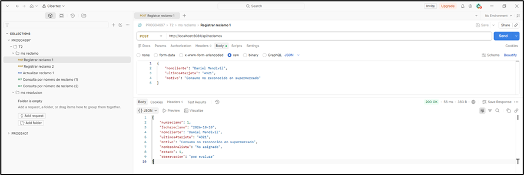
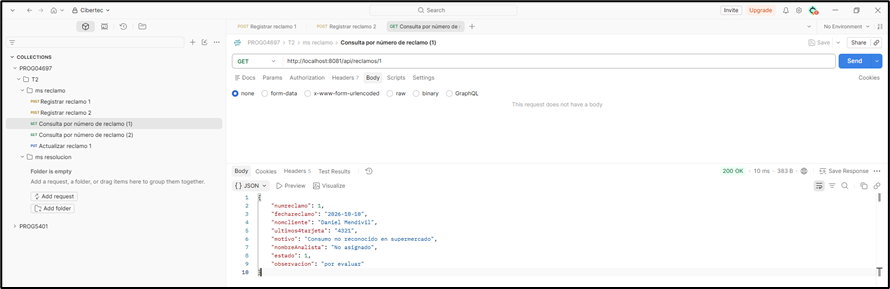
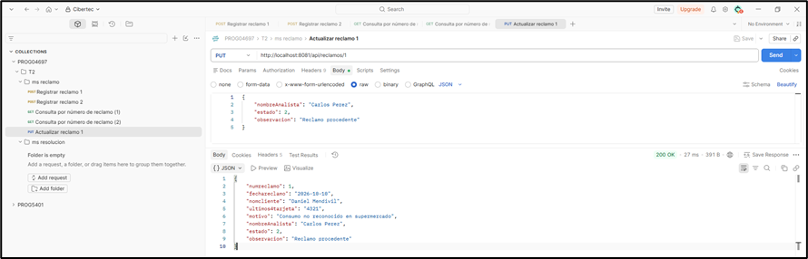
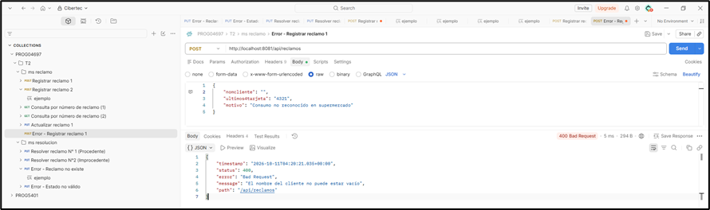
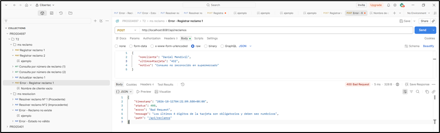
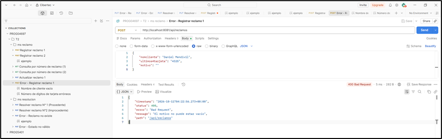
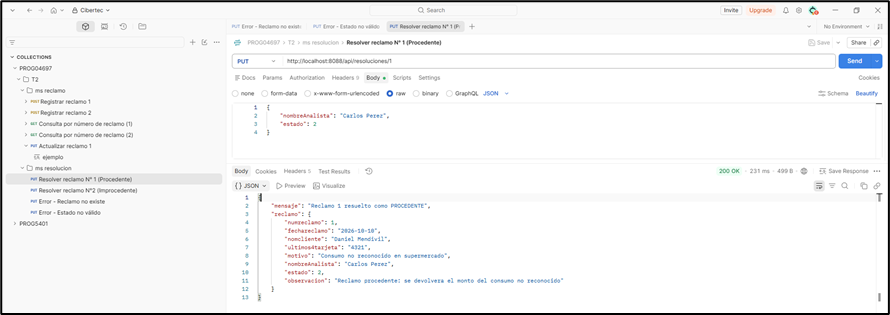
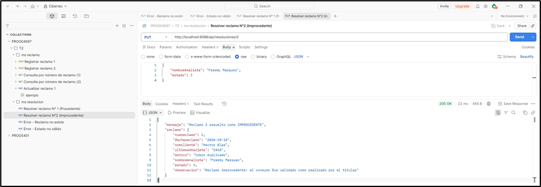
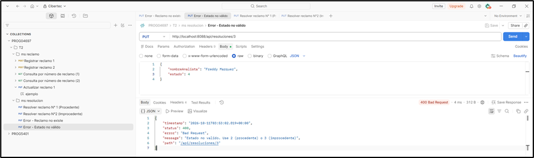
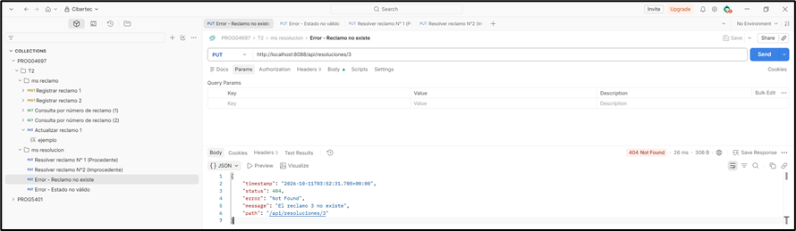

# 🚀 Sistema de Gestión de Reclamos - PAGOYA Perú

Sistema de microservicios desarrollado con **Spring Boot** y **Spring Cloud** para la gestión y resolución de reclamos por consumos desconocidos en tarjetas prepago de la fintech **PAGOYA Perú**.

---

## 🏗️ Arquitectura y Componentes

El sistema se compone de 3 microservicios independientes que se comunican y registran mediante un servidor de descubrimiento, utilizando una base de datos MySQL en el puerto 3306 con credenciales root / mysql:
1. **`eureka-server`** (Puerto: `8762`): Servidor de descubrimiento Netflix Eureka.
2. **`ms-reclamos`** (Puerto: `8081`): Microservicio encargado del registro, consulta y actualización de reclamos (conectado a MySQL).
3. **`ms-resolucion`** (Puerto: `8088`): Microservicio encargado de completar el proceso de resolución de reclamos, validando la existencia mediante **Spring Cloud OpenFeign** contra `ms-reclamos`.

## 🧪 Pruebas de Endpoints en Postman

A continuación se detallan las pruebas realizadas para validar el funcionamiento de ambos microservicios (`ms-reclamos` y `ms-resolucion`), incluyendo los casos de éxito y de control de errores.

### 1. Pruebas del Microservicio de Reclamos (`ms-reclamos`)

* **Registro de Reclamos (Éxito):** Se registra un nuevo reclamo con los datos del cliente, generando automáticamente los valores por defecto (`estado = 1`, `nombreAnalista = "No asignado"`, `observacion = "por evaluar"`).

  

* **Consulta de Reclamo por Número (Éxito):** Permite verificar el estado actual del reclamo registrado mediante su ID o número asignado.

  

* **Actualización de Reclamo por Número (Éxito):** Permite actualizar la información del analista encargado del reclamo, el estado del mismo y agregar una observación.

  

* **Validación de Errores en Registro:** Prueba el control de restricciones cuando se envían campos vacíos o con formatos incorrectos (como validar los 4 dígitos de la tarjeta).

    

---

### 2. Pruebas del Microservicio de Resolución (`ms-resolucion`)

* **Resolver Reclamo como Procedente (Éxito - Estado 2):** El área de riesgos completa la evaluación, validando la existencia del reclamo mediante OpenFeign, cambiando el estado a `2`, asignando el nombre del analista y actualizando la observación correspondiente.

  

* **Resolver Reclamo como Improcedente (Éxito - Estado 3):** Simula la resolución negativa de un caso con estado `3`.

  

* **Control de Errores - Estado no Válido:** Valida que el servicio rechace estados distintos a 2 o 3 (por ejemplo, enviar un número de estado inválido).

  

* **Control de Errores - Reclamo no Existe:** Valida que el microservicio de resolución maneje adecuadamente el error 404 cuando se intenta evaluar un ID de reclamo inexistente en el `ms-reclamos`.

  

